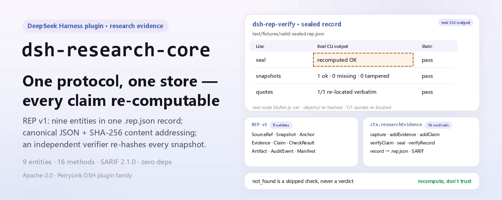
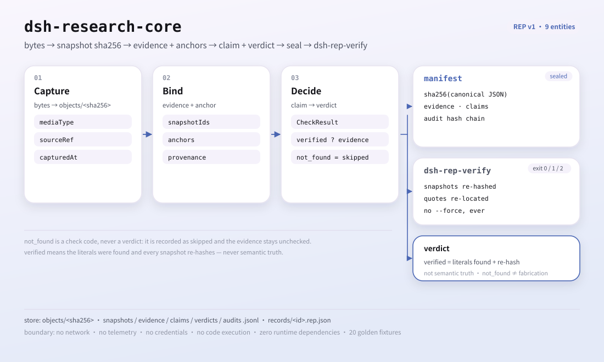
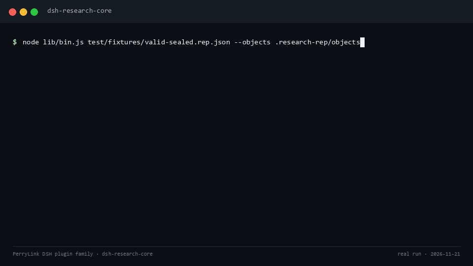

<div align="center">

<picture>
  <source media="(prefers-color-scheme: dark)" srcset="docs/assets/dsh-research-core-hero-en-dark.webp">
  
</picture>

# @perrylink/dsh-research-core

**REP v1 — el protocolo compartido de evidencia de investigación (Research Evidence Protocol) para la familia de plugins de investigación de DSH.**

*Un protocolo, un almacén, un verificador. Cada plugin de investigación habla el mismo lenguaje de evidencia y cualquiera puede recalcular lo que afirma.*

[English](README.md) · [简体中文](README-zh.md) · [Español](README-es.md) · [Português](README-pt.md) · [हिन्दी](README-hi.md)

[](LICENSE)
[]()
[](https://github.com/topics/dsh-plugin)

</div>

---

## Qué es esto

`dsh-research-core` es la **capa compartida** bajo una familia de 18 plugins de investigación pequeños e instalables de forma independiente. Hace tres cosas y nada más:

1. **Define REP v1** — un JSON Schema + tipos de TypeScript para `SourceRef`, `Snapshot`, `Anchor`, `Evidence`, `Claim`, `CheckResult`, `Artifact`, `AuditEvent` y `ReportManifest`, envueltos en un único archivo de intercambio `ResearchRecord` (`.rep.json`).
2. **Aporta primitivas deterministas** — direccionamiento por contenido SHA-256, JSON canónico, ids estables, validación de invariantes, verificación de registros byte a byte, sellado de manifests, eventos de auditoría encadenados por hash y exportación SARIF 2.1.0.
3. **Monta un servicio local opcional** (`ctx.researchEvidence`) respaldado por un almacén direccionado por contenido, más un puente estructural con el libro mayor existente de `dsh-research-report` (`ctx.researchReport`).

```
plugin output ──► REP record (.rep.json) ──► dsh-rep-verify ──► verified / failed
                        │
                        ├── schema/rep-v1.schema.json   (the contract)
                        ├── objects/<sha256>            (immutable bytes)
                        └── manifest seal               (sha256 of canonical JSON)
```

<picture>
  <source media="(prefers-color-scheme: dark)" srcset="docs/assets/dsh-research-core-flow-v5-dark.svg">
  
</picture>

*Estructura: capturar → enlazar → decidir; un manifest sellado y el informe independiente de `dsh-rep-verify` son las dos salidas, y cada hash de ambas se puede recalcular a partir de los bytes. Las etiquetas de token dentro del diagrama son los nombres reales de entidades, métodos y CLI, así que la misma imagen sirve para los cinco idiomas.*

## Qué no es esto

- **No es un recuperador.** Sin Crossref, sin PubMed, sin análisis de PDF — eso son los plugins.
- **No es un comprobador.** No decide si una afirmación está respaldada *semánticamente*; garantiza que los bytes, los localizadores y la contabilidad de veredictos sean reproducibles.
- **No es un banco de trabajo.** Sin UI, sin lector, sin editor.
- **No es un envoltorio de `dsh-research-report`.** Ese plugin conserva `ctx.researchReport` y su contrato `assemble` congelado byte a byte; core se adapta a él y nunca lo reescribe.

## Compatibilidad

| | |
|---|---|
| DeepSeek Harness | **`dsh-v0.2.3-alpha.1`** (verificado en esta máquina, 2026-11-22) — línea peer de npm `>=0.2.1-0 <0.3.0 \|\| >=0.2.2-0 <0.3.0` |
| Node | `^22.19.0 \|\| >=24.9.0` (probado en `24.22.1`), solo ESM |
| Peers | `@deepseek-ai/cordis ^4.0.5-alpha.1`, `@deepseek-ai/schemastery ^3.18.5-alpha.1` |
| Dependencias en tiempo de ejecución | **cero** |

## Instalación

```sh
# npm channel
dsh plugin --profile <name> add @perrylink/dsh-research-core

# git channel (pin a commit)
dsh plugin --profile <name> add github:PerryLink/dsh-research-core#<commit-sha>

# local checkout (development / smoke)
dsh plugin --profile <name> add file:/ruta/absoluta/a/dsh-research-core
```

Comprueba que la fila se monta:

```sh
dsh --profile <name> --dump-config | grep dsh-research-core
```

Desinstalar:

```sh
dsh plugin --profile <name> remove @perrylink/dsh-research-core
```

Montar el servicio es opcional para los consumidores: el paquete también funciona como biblioteca normal (`import { validateRep } from '@perrylink/dsh-research-core'`), así que un plugin puede usar REP sin depender de que el servicio esté montado.

## El protocolo (REP v1)

| Entidad | Propósito | Invariante dura |
|---|---|---|
| `SourceRef` | de dónde vino la evidencia (`doi` / `pmid` / `pmcid` / `arxiv` / `isbn` / `url` / `file` / `dataset` / `other`) | el patrón del id se aplica por tipo |
| `Snapshot` | bytes inmutables direccionados por contenido | `snapshotId = "sha256:<hex>"`; `path` DEBE ser igual a `objects/<hex>` |
| `Anchor` | un localizador dentro de un snapshot (`page` / `section` / `paragraph` / `char` / `table` / `figure` / `record`) | campos propios de cada tipo y formas canónicas de `value` (`p.3`, `c.10-40`, `para.7`, `t.2`, `f.1`, `field:title`) |
| `Evidence` | fuente + snapshot(s) + ancla(s) + procedencia (+ comprobaciones) | **al menos un snapshot y un ancla; la evidencia sin snapshot es inválida** |
| `CheckResult` | el resultado de una comprobación determinista (`pass`/`fail`/`warn`/`skipped`) con un `code` estable | `code:"not_found"` DEBE ser `skipped` |
| `Claim` | una afirmación, sus vínculos de evidencia, sus comprobaciones y su veredicto | **un veredicto exige ≥1 comprobación; `verified` exige ≥1 evidencia, ≥1 comprobación verificadora en `pass` y ninguna comprobación en `fail`** |
| `Artifact` | código / entorno / datos / seed / comando / figura / tabla | hash de contenido `sha256:<hex>` |
| `AuditEvent` | evento de solo adición encadenado por hash | `hash = sha256(canonicalJson(event minus hash))`; `prevHash` enlaza la cadena |
| `ReportManifest` | el resumen sellado del informe | `integrity.manifestHash = sha256(canonicalJson(manifest minus integrity))` |

### Semántica de los veredictos (importante)

| Veredicto | Significa | **No** significa |
|---|---|---|
| `verified` | los literales comprobables (citas/números/metadatos) se encontraron y cada snapshot vinculado se rehashea | que la afirmación sea *verdadera* en sentido semántico |
| `unverified` | no se comprobó nada (normalmente: ninguna evidencia vinculada) | falso |
| `insufficient` | la evidencia disponible no permite decidirlo (p. ej. un número podría ser calculado, no citado) | falso, y **tampoco** «limpio» |
| `contradicted` | un snapshot vinculado falló su comprobación de integridad, o un puente numérico no coincide | — |
| `disproven` | el texto de la fuente no contiene explícitamente la cita afirmada | — |

`not_found` es un **código de comprobación**, no un veredicto. Significa *que la fuente no se pudo localizar*. **No** es evidencia de fabricación ni evidencia de limpieza. Siempre se registra como `skipped`, y un elemento de evidencia cuyo único resultado es `not_found` se queda en `unchecked` — nunca en `ok`.

### Hashing canónico

Todos los hashes de REP se calculan sobre JSON canónico: claves de objeto ordenadas por unidad de código UTF-16, serialización de números de ECMAScript, sin espacios en blanco insignificantes, propiedades `undefined` omitidas, y rechazo de números no finitos / bigints / ciclos / subrogados sueltos. Para valores bien formados esto sigue la RFC 8785 (JCS).

## Inicio rápido (biblioteca)

```ts
import {
  buildManifest, sealManifest, validateRep, verifyManifestSeal,
  snapshotIdOf, canonicalJson, toSarif, renderRecordMarkdown,
} from '@perrylink/dsh-research-core'

const snapshot = {
  snapshotId: snapshotIdOf(bytes),
  mediaType: 'text/plain' as const,
  bytes: bytes.byteLength,
  path: `objects/${snapshotIdOf(bytes).slice('sha256:'.length)}`,
  capturedAt: '2026-01-15T10:00:00.000Z',
  sourceRef: { kind: 'file' as const, id: 'paper.txt', retrievedAt: '2026-01-15T10:00:00.000Z' },
}
// …build evidence/claims, then:
const result = validateRep(record)            // invariants, cross-refs, audit chain, seal
const sarif = toSarif(record, { version: '1.0.0' })
const markdown = renderRecordMarkdown(record)
```

## Inicio rápido (servicio)

```ts
// inside a research plugin that optionally injects researchEvidence
const service = ctx.get('researchEvidence') as ResearchEvidenceService | undefined
if (service !== undefined) {
  const { snapshot } = await service.capture({
    bytes: pdfBytes, mediaType: 'application/pdf',
    sourceRef: { kind: 'file', id: 'paper.pdf', retrievedAt: new Date().toISOString() },
  })
  await service.addEvidence({ sourceRef, snapshotIds: [snapshot.snapshotId], anchors, provenance })
  await service.addClaim({ text, type: 'result', evidenceRefs: [evidenceId], locator })
  const claim = await service.verifyClaim(claimId)       // records the verdict
  const sealed = await service.seal({ title, topic, generator })
  await service.verifyRecord(sealed.record)              // independent re-check
}
```

## CLI — verificación independiente

```sh
dsh-rep-verify <record.rep.json> [--objects <dir>] [--json] [--sarif]
```

```text
record     rec-fixture-sealed
manifest   9425dcf5… (sha256)
seal       recomputed OK
snapshots  1 ok · 0 missing · 0 tampered
quotes     1/1 re-located verbatim
issues     0 error(s) · 0 warning(s)
RESULT     verified
```

Códigos de salida: `0` verificado · `1` verificación fallida · `2` error de uso/IO.
Sin `--objects` se siguen comprobando los invariantes y el sello del registro, pero los hashes de los snapshots se informan como `not_checked` — la CLI nunca finge haber verificado bytes que no leyó.

## Herramientas y superficies

Este paquete **no registra ninguna herramienta visible para el modelo** por diseño (las herramientas son de los 18 plugins). Sus superficies son:

| Superficie | Nombre | Notas |
|---|---|---|
| Servicio | `ctx.researchEvidence` | 16 métodos: `capture`, `addEvidence`, `setEvidenceChecks`, `addClaim`, `setVerdict`, `verifyClaim`, `getSnapshot`, `getEvidence`, `getClaim`, `listSnapshots`, `listEvidence`, `listClaims`, `summarize`, `buildRecord`, `seal`, `verifyRecord`, más `attachReport` / `importReportEvidence` / `mirrorToReport` |
| CLI | `dsh-rep-verify` | guiada por código de salida, `--json` / `--sarif` |
| Schema | `./schema/rep-v1.schema.json` | JSON Schema 2020-12, `$id` publicado |
| Eventos | `RESEARCH_EVENTS` | `research/evidence.captured`, `research/claim.verified`, `research/audit.finding`, `research/report.sealed` (nombres + tipos del payload; emitirlos es tarea del plugin que los produce) |

## Configuración

| Clave | Por defecto | Significado |
|---|---|---|
| `enabled` | `true` | `false` no monta absolutamente nada |
| `root` | `.research-rep` | raíz del almacén, resuelta contra el directorio de trabajo del harness |
| `maxSnapshotBytes` | `20971520` (20 MiB) | tope de bytes por snapshot |
| `maxEvidence` | `10000` | registros de evidencia antes de sellar/podar |
| `maxClaims` | `10000` | registros de afirmaciones |

Los valores inválidos fallan de forma ruidosa al montar.

## Estructura del almacén

```
.research-rep/
├── objects/<sha256>          immutable snapshot bytes (atomic write, never overwritten)
├── snapshots.jsonl           snapshot registrations (first registration wins per address)
├── evidence.jsonl            evidence registrations
├── evidence-checks.jsonl     evidence checks (latest line wins)
├── claims.jsonl              claim registrations (immutable)
├── verdicts.jsonl            verdicts + their checks (latest line wins)
├── audits.jsonl              append-only hash-chained audit events
└── records/<id>.rep.json     sealed REP records
```

Cada diario es de solo adición. Una línea corrupta falla de forma ruidosa con archivo y número de línea en lugar de omitirse. Las lecturas rehashean los objetos de snapshot, así que una alteración se detecta, no se confía en ella.

## Permisos y datos

- **Local primero.** No hay ninguna llamada de red en todo el paquete. No se sube nada.
- **Sin telemetría.** Sin reportes ocultos, sin analítica.
- **Sin credenciales.** Nada aquí lee ni almacena tokens; la documentación de los payloads de auditoría dice que no deben contener secretos y el almacén es local al workspace.
- **Sin tratamiento de datos personales por sí mismo.** La captura es explícita: un plugin decide qué bytes se convierten en snapshot. No hagas snapshot de datos personales salvo que la política de tu plugin lo permita.
- **Sin ejecución de código.** Nunca se ejecuta un PDF/HTML/script; la CLI solo lee JSON.

## Límites de seguridad

- El `path` del snapshot debe ser `objects/<hex>` — el path traversal no se puede expresar en un registro válido.
- Los ids de registro se validan contra un patrón estricto antes de construir cualquier nombre de archivo.
- Los objetos se escriben con el patrón temp + rename tipo `O_EXCL` y **nunca se sobrescriben**: si los bytes almacenados ya no hashean a su dirección, el almacén rechaza (`SNAPSHOT_TAMPERED`) en lugar de «repararlo».
- Un registro sellado nunca se sobrescribe (`RECORD_EXISTS`).
- Hashear un snapshot que no coincide es un fallo de verificación duro; no existe `--force`.

## Limitaciones conocidas

- **La verificación de citas a nivel de registro necesita snapshots textuales.** Un snapshot PDF se guarda y se rehashea, pero aquí no se extrae su texto; reubicar citas en PDFs exige que `dsh-doc-anchor` capture también el texto extraído como snapshot `text/plain`.
- **Las comprobaciones de citas a nivel de registro cubren las anclas de evidencia.** `verifyRecord`/`dsh-rep-verify` reubican las citas en `Evidence.anchors`; el `locator.quote` de una afirmación lo evalúan `evaluateClaim`/`verifyClaim`, porque una afirmación `disproven` lleva intencionadamente una cita que debe estar *ausente*.
- **`verifyClaim` es conservador.** Un número ausente da `insufficient` (podría ser calculado), no `disproven`; solo una cita literal ausente es `disproven`. El respaldo semántico es tarea de `dsh-claim-check` (W2).
- **Todavía no se emiten eventos al registro de sesión.** Los nombres y payloads de los eventos están exportados; emitirlos requiere un enganche de sesión y queda en manos del plugin que los produce.
- **Suposición de un solo escritor.** El almacén serializa las escrituras con un lock en proceso; dos procesos que escriban la misma raíz a la vez no se coordinan.
- **Forma del schema frente a invariantes.** `validateRep` comprueba referencias cruzadas e invariantes (y una pasada estructural defensiva previa); el JSON Schema es la autoridad sobre la forma. El almacén sin dependencias aplica referencias cruzadas e invariantes, no todas las restricciones del JSON Schema (por ejemplo las cotas de longitud), así que los productores no confiables deben validar contra `schema/rep-v1.schema.json` en su frontera. CI comprueba ambas cosas contra los 20 fixtures dorados.

## Evaluación



*Animado: la salida real de `dsh-rep-verify` el 2026-11-21 — primero `test/fixtures/valid-sealed.rep.json` verificado contra un directorio `objects/` construido a partir de su propio snapshot (el sello se recompone, los bytes se rehashean y el ancla citada se reubica); después `test/fixtures/invalid-manifest-seal.rep.json`, el mismo registro con su título editado tras el sellado, que el verificador rechaza. Códigos de salida: 0 verificado, 1 fallido, 2 uso/IO.*

Este paquete **no tiene ni reclama cifras de precision/recall**: es infraestructura de protocolo, no un detector. Lo que se mide:

- **115 tests unitarios/de integración** en 11 archivos (`pnpm test`), que cubren: determinismo del JSON canónico, vectores SHA-256, evaluación de afirmaciones (5 rutas de veredicto), validación de invariantes, manipulación de la cadena de auditoría, sellado de manifests, durabilidad del almacén, detección de alteraciones, montaje/desmontaje en Cordis, el puente con research-report y los códigos de salida de la CLI.
- **20 fixtures dorados** (`test/fixtures/*.rep.json`), 3 válidos + 17 inválidos de causa única, regenerados de forma determinista por las funciones reales y con puerta contra deriva (`UPDATE_FIXTURES=1 pnpm test`).
- **Acuerdo con el JSON Schema**: el schema publicado acepta todos los fixtures válidos y rechaza los inválidos estructurales; los fixtures semánticos se marcan como `either` y los cubre `validateRep`.

Los detectores de comportamiento (`dsh-cite-verify`, `dsh-claim-check`, `dsh-statcheck`) llevan sus propias cifras de precision/recall contra `dsh-research-bench`.

## Desarrollo

```sh
pnpm install
pnpm run typecheck     # sources + tests (TypeScript strict, exactOptionalPropertyTypes)
pnpm test              # vitest
pnpm run build         # tsc → lib/
pnpm run verify:package
UPDATE_FIXTURES=1 pnpm test   # regenerate golden fixtures after an intentional change
```

## Licencia

Apache-2.0. Sin código de terceros en tiempo de ejecución; las dependencias de desarrollo son herramientas MIT/Apache-2.0.
