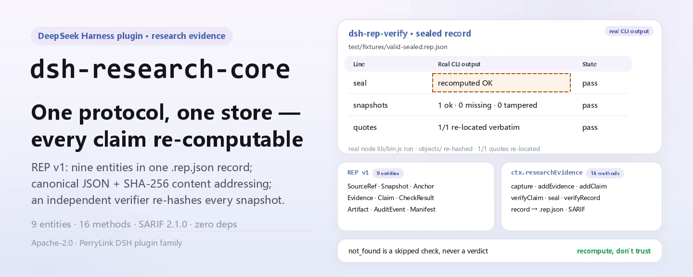
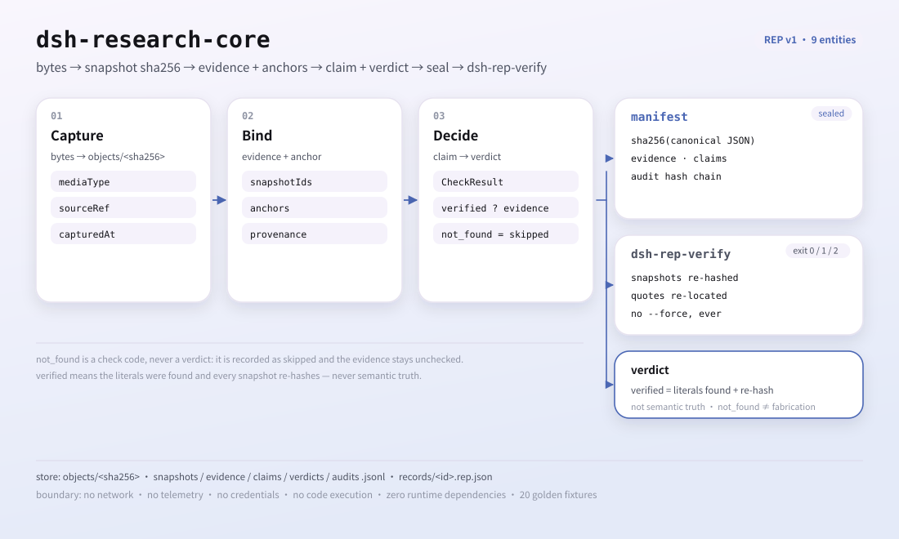
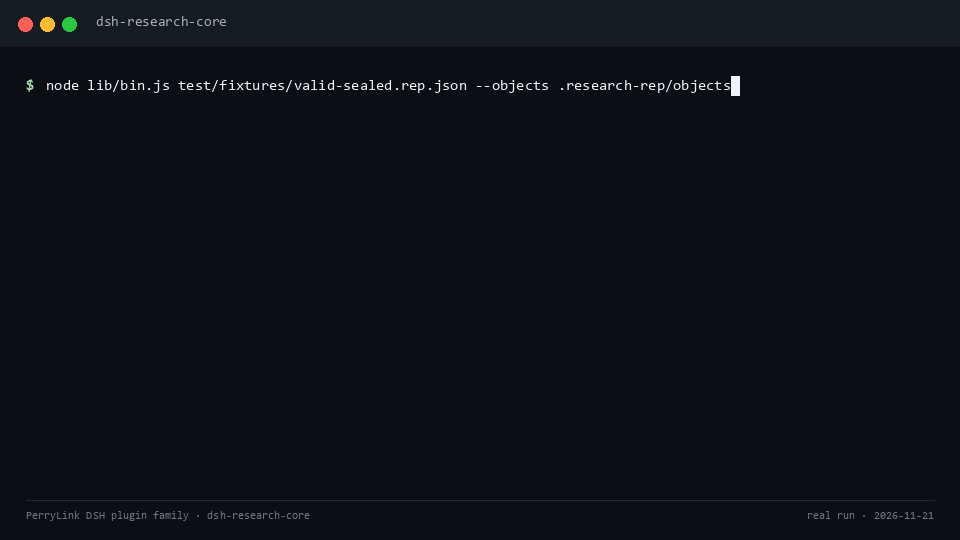

<div align="center">

<picture>
  <source media="(prefers-color-scheme: dark)" srcset="docs/assets/dsh-research-core-hero-en-dark.webp">
  
</picture>

# @perrylink/dsh-research-core

**REP v1 — DSH रिसर्च प्लगइन परिवार के लिए साझा Research Evidence Protocol।**

*एक प्रोटोकॉल, एक स्टोर, एक वेरिफ़ायर। हर रिसर्च प्लगइन एक ही एविडेंस भाषा बोलता है, और कोई भी उसके दावे को दोबारा गणना कर सकता है।*

[English](README.md) · [简体中文](README-zh.md) · [Español](README-es.md) · [Português](README-pt.md) · [हिन्दी](README-hi.md)

[](LICENSE)
[]()
[](https://github.com/topics/dsh-plugin)

</div>

---

## यह क्या है

`dsh-research-core` 18 छोटे, स्वतंत्र रूप से इंस्टॉल होने वाले रिसर्च प्लगइन के परिवार के नीचे की **साझा परत** है। यह तीन काम करता है और बस इतना ही:

1. **REP v1 परिभाषित करता है** — `SourceRef`, `Snapshot`, `Anchor`, `Evidence`, `Claim`, `CheckResult`, `Artifact`, `AuditEvent` और `ReportManifest` के लिए JSON Schema + TypeScript टाइप, एक ही `ResearchRecord` इंटरचेंज फ़ाइल (`.rep.json`) में लिपटे हुए।
2. **नियतात्मक प्रिमिटिव देता है** — SHA-256 कंटेंट एड्रेसिंग, कैनोनिकल JSON, स्थिर id, इनवेरिएंट वैलिडेशन, बाइट-स्तरीय रिकॉर्ड सत्यापन, manifest सीलिंग, हैश-चेन ऑडिट इवेंट और SARIF 2.1.0 निर्यात।
3. **वैकल्पिक स्थानीय सेवा माउंट करता है** (`ctx.researchEvidence`) जो कंटेंट-एड्रेस्ड स्टोर पर टिकी है, साथ ही मौजूदा `dsh-research-report` लेजर (`ctx.researchReport`) के लिए एक संरचनात्मक पुल।

```
plugin output ──► REP record (.rep.json) ──► dsh-rep-verify ──► verified / failed
                        │
                        ├── schema/rep-v1.schema.json   (the contract)
                        ├── objects/<sha256>            (immutable bytes)
                        └── manifest seal               (sha256 of canonical JSON)
```


<picture>
  <source media="(prefers-color-scheme: dark)" srcset="docs/assets/dsh-research-core-flow-v5-dark.svg">
  
</picture>

*संरचना: कैप्चर → बाइंड → निर्णय; सीलबंद manifest और स्वतंत्र `dsh-rep-verify` रिपोर्ट दो आउटपुट हैं, और दोनों का हर हैश बाइट्स से दोबारा गणना योग्य है। आरेख के अंदर के टोकन लेबल असली एंटिटी, मेथड और CLI नाम हैं, इसलिए एक ही चित्र पाँचों भाषाओं के लिए काम करता है।*

## यह क्या नहीं है

- **रिट्रीवर नहीं।** न Crossref, न PubMed, न PDF पार्सिंग — वे प्लगइन का काम है।
- **चेकर नहीं।** यह तय नहीं करता कि कोई दावा *अर्थ के स्तर पर* समर्थित है या नहीं; यह गारंटी देता है कि बाइट्स, लोकेटर और वर्डिक्ट का हिसाब दोबारा बनाया जा सके।
- **वर्कबेंच नहीं।** कोई UI नहीं, कोई रीडर नहीं, कोई एडिटर नहीं।
- **`dsh-research-report` का रैपर नहीं।** वह प्लगइन `ctx.researchReport` और अपना बाइट-फ़्रोज़न `assemble` कॉन्ट्रैक्ट रखता है; core उसके अनुकूल होता है और उसे कभी नहीं लिखता।

## अनुकूलता

| | |
|---|---|
| DeepSeek Harness | **`dsh-v0.2.2-rc.4`** (इस मशीन पर सत्यापित, 2026-11-18) — npm peer लाइन `>=0.2.1-0 <0.3.0 \|\| >=0.2.2-0 <0.3.0` |
| Node | `^22.19.0 \|\| >=24.9.0` (`24.22.1` पर परीक्षित), केवल ESM |
| Peers | `@deepseek-ai/cordis ^4.0.5-alpha.1`, `@deepseek-ai/schemastery ^3.18.5-alpha.1` |
| रनटाइम निर्भरताएँ | **शून्य** |

## इंस्टॉल

```sh
# npm channel
dsh plugin --profile <name> add @perrylink/dsh-research-core

# git channel (pin a commit)
dsh plugin --profile <name> add github:PerryLink/dsh-research-core#<commit-sha>

# local checkout (development / smoke)
dsh plugin --profile <name> add file:/absolute/path/to/dsh-research-core
```

जाँचें कि पंक्ति माउंट होती है:

```sh
dsh --profile <name> --dump-config | grep dsh-research-core
```

अनइंस्टॉल:

```sh
dsh plugin --profile <name> remove @perrylink/dsh-research-core
```

उपभोक्ताओं के लिए माउंट करना वैकल्पिक है: पैकेज सामान्य लाइब्रेरी की तरह भी काम करता है (`import { validateRep } from '@perrylink/dsh-research-core'`), इसलिए कोई प्लगइन सेवा माउंट होने पर निर्भर हुए बिना REP इस्तेमाल कर सकता है।

## प्रोटोकॉल (REP v1)

| एंटिटी | उद्देश्य | कठोर इनवेरिएंट |
|---|---|---|
| `SourceRef` | एविडेंस कहाँ से आया (`doi` / `pmid` / `pmcid` / `arxiv` / `isbn` / `url` / `file` / `dataset` / `other`) | id पैटर्न प्रति kind लागू होता है |
| `Snapshot` | अपरिवर्तनीय, कंटेंट-एड्रेस्ड बाइट्स | `snapshotId = "sha256:<hex>"`; `path` MUST `objects/<hex>` के बराबर हो |
| `Anchor` | एक snapshot के भीतर लोकेटर (`page` / `section` / `paragraph` / `char` / `table` / `figure` / `record`) | kind-विशिष्ट फ़ील्ड और कैनोनिकल `value` रूप (`p.3`, `c.10-40`, `para.7`, `t.2`, `f.1`, `field:title`) |
| `Evidence` | स्रोत + snapshot(s) + एंकर(s) + प्रोवेनेंस (+ जाँचें) | **कम से कम एक snapshot और एक एंकर; snapshot के बिना एविडेंस अमान्य है** |
| `CheckResult` | एक नियतात्मक जाँच परिणाम (`pass`/`fail`/`warn`/`skipped`) और स्थिर `code` | `code:"not_found"` MUST `skipped` हो |
| `Claim` | एक दावा, उसके एविडेंस बाइंडिंग, उसकी जाँचें, उसका वर्डिक्ट | **वर्डिक्ट के लिए ≥1 जाँच ज़रूरी; `verified` के लिए ≥1 एविडेंस, ≥1 पास होती सत्यापन-जाँच और कोई विफल जाँच नहीं** |
| `Artifact` | कोड / env / डेटा / seed / कमांड / चित्र / तालिका | `sha256:<hex>` कंटेंट हैश |
| `AuditEvent` | केवल-जोड़ने वाला, हैश-चेन इवेंट | `hash = sha256(canonicalJson(event minus hash))`; `prevHash` चेन जोड़ता है |
| `ReportManifest` | सीलबंद रिपोर्ट सारांश | `integrity.manifestHash = sha256(canonicalJson(manifest minus integrity))` |

### वर्डिक्ट का अर्थ (महत्वपूर्ण)

| वर्डिक्ट | अर्थ | यह **नहीं** |
|---|---|---|
| `verified` | जाँचने योग्य लिटरल (उद्धरण/संख्याएँ/मेटाडेटा) मिल गए और हर बद्ध snapshot फिर से हैश होता है | दावा अर्थ के स्तर पर *सत्य* है |
| `unverified` | कुछ भी जाँचा नहीं गया (आमतौर पर: कोई एविडेंस बद्ध नहीं) | असत्य |
| `insufficient` | उपलब्ध एविडेंस निर्णय नहीं दे सकता (जैसे कोई संख्या उद्धृत नहीं, गणना की जा सकती है) | असत्य, और **«साफ़» भी नहीं** |
| `contradicted` | किसी बद्ध snapshot की इंटीग्रिटी जाँच विफल हुई, या कोई संख्यात्मक पुल मेल नहीं खाता | — |
| `disproven` | स्रोत टेक्स्ट में दावा किया गया उद्धरण स्पष्ट रूप से मौजूद नहीं है | — |

`not_found` एक **जाँच कोड** है, वर्डिक्ट नहीं। इसका अर्थ है *स्रोत का पता नहीं चला*। यह **न** फ़ैब्रिकेशन का सबूत है और **न** सफ़ाई का सबूत। इसे हमेशा `skipped` के रूप में दर्ज किया जाता है, और जिस एविडेंस आइटम का एकमात्र परिणाम `not_found` हो वह `unchecked` रहता है — कभी `ok` नहीं।

### कैनोनिकल हैशिंग

REP के सभी हैश कैनोनिकल JSON पर गणना किए जाते हैं: ऑब्जेक्ट कुंजियाँ UTF-16 कोड यूनिट से क्रमबद्ध, ECMAScript संख्या सीरियलाइज़ेशन, कोई अनावश्यक व्हाइटस्पेस नहीं, `undefined` गुण छोड़े गए, और अनंत-नहीं संख्याएँ / bigint / चक्र / अकेले सरोगेट अस्वीकार। सुगठित मानों के लिए यह RFC 8785 (JCS) का पालन करता है।

## त्वरित शुरुआत (लाइब्रेरी)

```ts
import {
  buildManifest, sealManifest, validateRep, verifyManifestSeal,
  snapshotIdOf, canonicalJson, toSarif, renderRecordMarkdown,
} from '@perrylink/dsh-research-core'

const snapshot = {
  snapshotId: snapshotIdOf(bytes),
  mediaType: 'text/plain' as const,
  bytes: bytes.byteLength,
  path: `objects/${snapshotIdOf(bytes).slice('sha256:'.length)}`,
  capturedAt: '2026-01-15T10:00:00.000Z',
  sourceRef: { kind: 'file' as const, id: 'paper.txt', retrievedAt: '2026-01-15T10:00:00.000Z' },
}
// …build evidence/claims, then:
const result = validateRep(record)            // invariants, cross-refs, audit chain, seal
const sarif = toSarif(record, { version: '1.0.0' })
const markdown = renderRecordMarkdown(record)
```

## त्वरित शुरुआत (सेवा)

```ts
// inside a research plugin that optionally injects researchEvidence
const service = ctx.get('researchEvidence') as ResearchEvidenceService | undefined
if (service !== undefined) {
  const { snapshot } = await service.capture({
    bytes: pdfBytes, mediaType: 'application/pdf',
    sourceRef: { kind: 'file', id: 'paper.pdf', retrievedAt: new Date().toISOString() },
  })
  await service.addEvidence({ sourceRef, snapshotIds: [snapshot.snapshotId], anchors, provenance })
  await service.addClaim({ text, type: 'result', evidenceRefs: [evidenceId], locator })
  const claim = await service.verifyClaim(claimId)       // records the verdict
  const sealed = await service.seal({ title, topic, generator })
  await service.verifyRecord(sealed.record)              // independent re-check
}
```

## CLI — स्वतंत्र सत्यापन

```sh
dsh-rep-verify <record.rep.json> [--objects <dir>] [--json] [--sarif]
```

```text
record     rec-fixture-sealed
manifest   9425dcf5… (sha256)
seal       recomputed OK
snapshots  1 ok · 0 missing · 0 tampered
quotes     1/1 re-located verbatim
issues     0 error(s) · 0 warning(s)
RESULT     verified
```

एग्ज़िट कोड: `0` सत्यापित · `1` सत्यापन विफल · `2` उपयोग/IO त्रुटि।
`--objects` के बिना रिकॉर्ड के इनवेरिएंट और सील फिर भी जाँचे जाते हैं, पर snapshot हैश `not_checked` बताए जाते हैं — CLI कभी ऐसा दिखावा नहीं करती कि जो बाइट्स उसने नहीं पढ़ीं उन्हें सत्यापित कर लिया।

## टूल और सरफ़ेस

यह पैकेज डिज़ाइन से **कोई भी मॉडल-दृश्य टूल रजिस्टर नहीं करता** (टूल 18 प्लगइन के हैं)। इसके सरफ़ेस हैं:

| सरफ़ेस | नाम | टिप्पणियाँ |
|---|---|---|
| सेवा | `ctx.researchEvidence` | 16 मेथड: `capture`, `addEvidence`, `setEvidenceChecks`, `addClaim`, `setVerdict`, `verifyClaim`, `getSnapshot`, `getEvidence`, `getClaim`, `listSnapshots`, `listEvidence`, `listClaims`, `summarize`, `buildRecord`, `seal`, `verifyRecord`, साथ में `attachReport` / `importReportEvidence` / `mirrorToReport` |
| CLI | `dsh-rep-verify` | एग्ज़िट कोड से चलती है, `--json` / `--sarif` |
| Schema | `./schema/rep-v1.schema.json` | JSON Schema 2020-12, `$id` प्रकाशित |
| इवेंट | `RESEARCH_EVENTS` | `research/evidence.captured`, `research/claim.verified`, `research/audit.finding`, `research/report.sealed` (नाम + payload टाइप; उन्हें भेजना उत्पादक प्लगइन का काम है) |

## कॉन्फ़िगरेशन

| कुंजी | डिफ़ॉल्ट | अर्थ |
|---|---|---|
| `enabled` | `true` | `false` कुछ भी माउंट नहीं करता |
| `root` | `.research-rep` | स्टोर रूट, harness कार्यशील डायरेक्टरी के सापेक्ष |
| `maxSnapshotBytes` | `20971520` (20 MiB) | प्रति snapshot बाइट सीमा |
| `maxEvidence` | `10000` | सील/प्रून से पहले एविडेंस पंजीकरण |
| `maxClaims` | `10000` | दावा पंजीकरण |

अमान्य मान माउंट के समय ज़ोर से विफल होते हैं।

## स्टोर लेआउट

```
.research-rep/
├── objects/<sha256>          immutable snapshot bytes (atomic write, never overwritten)
├── snapshots.jsonl           snapshot registrations (first registration wins per address)
├── evidence.jsonl            evidence registrations
├── evidence-checks.jsonl     evidence checks (latest line wins)
├── claims.jsonl              claim registrations (immutable)
├── verdicts.jsonl            verdicts + their checks (latest line wins)
├── audits.jsonl              append-only hash-chained audit events
└── records/<id>.rep.json     sealed REP records
```

हर जर्नल केवल-जोड़ने वाला है। ख़राब जर्नल पंक्ति चुपचाप छोड़ने के बजाय फ़ाइल और पंक्ति संख्या के साथ ज़ोर से विफल होती है। पढ़ते समय snapshot ऑब्जेक्ट फिर से हैश होते हैं, इसलिए छेड़छाड़ पकड़ी जाती है, उस पर भरोसा नहीं किया जाता।

## अनुमतियाँ और डेटा

- **स्थानीय पहले।** इस पैकेज में कहीं कोई नेटवर्क कॉल नहीं। कुछ भी अपलोड नहीं होता।
- **कोई टेलीमेट्री नहीं।** कोई छिपी रिपोर्टिंग नहीं, कोई एनालिटिक्स नहीं।
- **कोई क्रेडेंशियल नहीं।** यहाँ कुछ भी टोकन नहीं पढ़ता या सहेजता; ऑडिट payload पर दस्तावेज़ी रूप से रहस्य न रखने का नियम है और स्टोर workspace-स्थानीय है।
- **अपने आप कोई PII उपचार नहीं।** कैप्चर स्पष्ट है: कौन से बाइट्स snapshot बनेंगे, यह प्लगइन तय करता है। जब तक आपके प्लगइन की नीति न कहे, व्यक्तिगत डेटा का snapshot न बनाएँ।
- **कोई कोड निष्पादन नहीं।** कोई PDF/HTML/स्क्रिप्ट कभी नहीं चलता; CLI केवल JSON पढ़ती है।

## सुरक्षा सीमाएँ

- snapshot का `path` `objects/<hex>` होना चाहिए — मान्य रिकॉर्ड में path traversal व्यक्त ही नहीं हो सकता।
- कोई भी फ़ाइल नाम बनाने से पहले रिकॉर्ड id एक कठोर id पैटर्न पर जाँचे जाते हैं।
- ऑब्जेक्ट `O_EXCL`-शैली temp + rename से लिखे जाते हैं और **कभी अधिलिखित नहीं होते**: अगर संग्रहीत बाइट्स अब अपने पते पर हैश नहीं होते, तो स्टोर «सुधार» करने के बजाय मना कर देता है (`SNAPSHOT_TAMPERED`)।
- सीलबंद रिकॉर्ड कभी अधिलिखित नहीं होता (`RECORD_EXISTS`)।
- मेल न खाने वाले snapshot को हैश करना कठोर सत्यापन विफलता है; कोई `--force` नहीं है।

## ज्ञात सीमाएँ

- **रिकॉर्ड-स्तरीय उद्धरण सत्यापन के लिए टेक्स्टुअल snapshot चाहिए।** PDF snapshot सहेजा और फिर से हैश होता है, पर उसका टेक्स्ट यहाँ नहीं निकाला जाता; PDF के उद्धरण पुनःस्थापित करने के लिए `dsh-doc-anchor` को निकाला गया टेक्स्ट भी `text/plain` snapshot के रूप में कैप्चर करना होगा।
- **रिकॉर्ड-स्तरीय उद्धरण जाँचें एविडेंस एंकर कवर करती हैं।** `verifyRecord`/`dsh-rep-verify` `Evidence.anchors` पर उद्धरण पुनःस्थापित करते हैं; दावा-स्तरीय `locator.quote` को `evaluateClaim`/`verifyClaim` आँकते हैं, क्योंकि `disproven` दावा जानबूझकर ऐसा उद्धरण रखता है जो *अनुपस्थित* होना चाहिए।
- **`verifyClaim` रूढ़िवादी है।** अनुपस्थित संख्या `insufficient` देती है (वह गणना हो सकती है), `disproven` नहीं; केवल शब्दशः अनुपस्थित उद्धरण `disproven` है। अर्थ-स्तरीय समर्थन `dsh-claim-check` का काम है (W2)।
- **अभी सत्र-लॉग इवेंट उत्सर्जन नहीं।** इवेंट नाम/payload निर्यात हैं; उन्हें भेजने के लिए session seam चाहिए और यह उत्पादक प्लगइन पर छोड़ा गया है।
- **एकल-लेखक धारणा।** स्टोर लिखावटों को इन-प्रोसेस लॉक से क्रमबद्ध करता है; एक ही रूट पर साथ लिखते दो प्रोसेस समन्वित नहीं होते।
- **Schema आकार बनाम इनवेरिएंट।** `validateRep` क्रॉस-रेफ़रेंस और इनवेरिएंट जाँचता है (साथ में एक रक्षात्मक संरचनात्मक पूर्व-पास); आकार का अधिकारी JSON Schema है। शून्य-निर्भरता स्टोर क्रॉस-रेफ़रेंस और इनवेरिएंट लागू करता है, हर JSON-Schema बाधा (जैसे लंबाई सीमाएँ) नहीं, इसलिए अविश्वसनीय उत्पादकों को अपनी सीमा पर `schema/rep-v1.schema.json` के विरुद्ध सत्यापित करना चाहिए। CI दोनों को 20 गोल्डन fixture के विरुद्ध जाँचती है।

## मूल्यांकन



*एनिमेटेड: 2026-11-21 को `dsh-rep-verify` का असली आउटपुट — पहले `test/fixtures/valid-sealed.rep.json` अपने ही snapshot से बनी `objects/` डायरेक्टरी के विरुद्ध सत्यापित (सील फिर से गणना, बाइट्स फिर से हैश, उद्धृत एंकर पुनःस्थापित); फिर `test/fixtures/invalid-manifest-seal.rep.json`, यानी वही रिकॉर्ड जिसका शीर्षक सील के बाद बदला गया, जिसे वेरिफ़ायर अस्वीकार करता है। एग्ज़िट कोड: 0 सत्यापित, 1 विफल, 2 उपयोग/IO।*


इस पैकेज के **precision/recall के आँकड़े न हैं और न यह उनका दावा करता है**: यह प्रोटोकॉल इंफ़्रास्ट्रक्चर है, डिटेक्टर नहीं। जो मापा जाता है:

- **11 फ़ाइलों में 115 यूनिट/इंटीग्रेशन टेस्ट** (`pnpm test`), जो कवर करते हैं: कैनोनिकल JSON की नियतात्मकता, SHA-256 वेक्टर, दावा मूल्यांकन (5 वर्डिक्ट पथ), इनवेरिएंट वैलिडेशन, ऑडिट चेन से छेड़छाड़, manifest सीलिंग, स्टोर टिकाऊपन, छेड़छाड़ पकड़ना, Cordis माउंट/डिस्पोज़, research-report पुल और CLI एग्ज़िट कोड।
- **20 गोल्डन fixture** (`test/fixtures/*.rep.json`), 3 मान्य + 17 एक-कारण अमान्य, असली फंक्शनों से नियतात्मक रूप से पुनर्जनित और ड्रिफ़्ट के विरुद्ध गेटेड (`UPDATE_FIXTURES=1 pnpm test`)।
- **JSON Schema समझौता**: प्रकाशित schema हर मान्य fixture स्वीकारता है और संरचनात्मक अमान्य को अस्वीकारता है; अर्थ-संबंधी fixture `either` चिह्नित होते हैं और `validateRep` से कवर होते हैं।

व्यवहार-डिटेक्टर (`dsh-cite-verify`, `dsh-claim-check`, `dsh-statcheck`) अपने precision/recall आँकड़े `dsh-research-bench` के विरुद्ध ख़ुद रिपोर्ट करते हैं।

## डेवलपमेंट

```sh
pnpm install
pnpm run typecheck     # sources + tests (TypeScript strict, exactOptionalPropertyTypes)
pnpm test              # vitest
pnpm run build         # tsc → lib/
pnpm run verify:package
UPDATE_FIXTURES=1 pnpm test   # regenerate golden fixtures after an intentional change
```

## लाइसेंस

Apache-2.0. रनटाइम में कोई तृतीय-पक्ष कोड नहीं; डेवलपमेंट निर्भरताएँ MIT/Apache-2.0 टूलिंग हैं।
