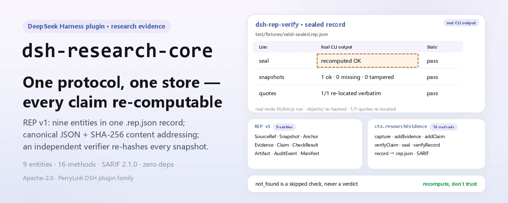
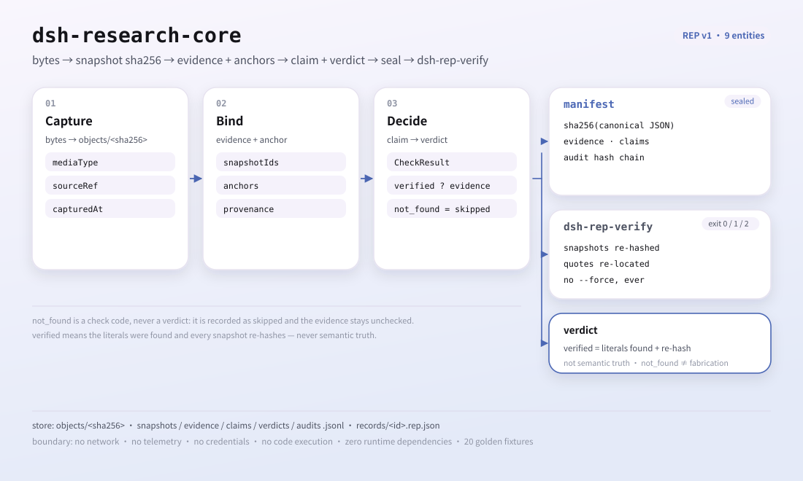
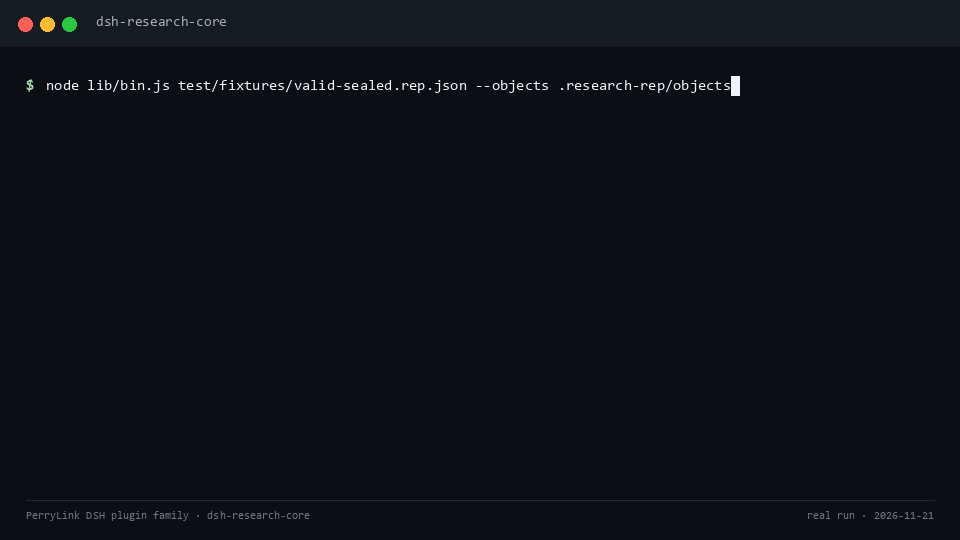

<div align="center">

<picture>
  <source media="(prefers-color-scheme: dark)" srcset="docs/assets/dsh-research-core-hero-en-dark.webp">
  
</picture>

# @perrylink/dsh-research-core

**REP v1 — o protocolo compartilhado de evidência de pesquisa (Research Evidence Protocol) da família de plugins de pesquisa do DSH.**

*Um protocolo, um armazenamento, um verificador. Todo plugin de pesquisa fala a mesma língua de evidência e qualquer pessoa pode recalcular o que ele afirma.*

[English](README.md) · [简体中文](README-zh.md) · [Español](README-es.md) · [Português](README-pt.md) · [हिन्दी](README-hi.md)

[](LICENSE)
[]()
[](https://github.com/topics/dsh-plugin)

</div>

---

## O que é isto

`dsh-research-core` é a **camada compartilhada** sob uma família de 18 plugins de pesquisa pequenos e instaláveis de forma independente. Ele faz três coisas e nada mais:

1. **Define o REP v1** — um JSON Schema + tipos TypeScript para `SourceRef`, `Snapshot`, `Anchor`, `Evidence`, `Claim`, `CheckResult`, `Artifact`, `AuditEvent` e `ReportManifest`, envolvidos em um único arquivo de intercâmbio `ResearchRecord` (`.rep.json`).
2. **Fornece primitivas determinísticas** — endereçamento por conteúdo SHA-256, JSON canônico, ids estáveis, validação de invariantes, verificação de registro byte a byte, selagem de manifest, eventos de auditoria encadeados por hash e exportação SARIF 2.1.0.
3. **Monta um serviço local opcional** (`ctx.researchEvidence`) apoiado por um armazenamento endereçado por conteúdo, mais uma ponte estrutural com o livro-razão existente do `dsh-research-report` (`ctx.researchReport`).

```
plugin output ──► REP record (.rep.json) ──► dsh-rep-verify ──► verified / failed
                        │
                        ├── schema/rep-v1.schema.json   (the contract)
                        ├── objects/<sha256>            (immutable bytes)
                        └── manifest seal               (sha256 of canonical JSON)
```

<picture>
  <source media="(prefers-color-scheme: dark)" srcset="docs/assets/dsh-research-core-flow-v5-dark.svg">
  
</picture>

*Estrutura: capturar → vincular → decidir; um manifest selado e o relatório independente do `dsh-rep-verify` são as duas saídas, e cada hash de ambos é recalculável a partir dos bytes. Os rótulos de token dentro do diagrama são os nomes reais de entidades, métodos e CLI, então a mesma imagem serve para os cinco idiomas.*

## O que isto não é

- **Não é um recuperador.** Sem Crossref, sem PubMed, sem parsing de PDF — isso são os plugins.
- **Não é um verificador de conteúdo.** Não decide se uma afirmação é *semanticamente* sustentada; garante que os bytes, os localizadores e a contabilidade de veredictos sejam reproduzíveis.
- **Não é uma bancada de trabalho.** Sem UI, sem leitor, sem editor.
- **Não é um wrapper do `dsh-research-report`.** Aquele plugin mantém `ctx.researchReport` e seu contrato `assemble` congelado byte a byte; o core se adapta a ele e nunca o reescreve.

## Compatibilidade

| | |
|---|---|
| DeepSeek Harness | **`dsh-v0.2.3-alpha.1`** (verificado nesta máquina, 2026-11-22) — linha peer do npm `>=0.2.1-0 <0.3.0 \|\| >=0.2.2-0 <0.3.0` |
| Node | `^22.19.0 \|\| >=24.9.0` (testado em `24.22.1`), somente ESM |
| Peers | `@deepseek-ai/cordis ^4.0.5-alpha.1`, `@deepseek-ai/schemastery ^3.18.5-alpha.1` |
| Dependências em tempo de execução | **zero** |

## Instalação

```sh
# npm channel
dsh plugin --profile <name> add @perrylink/dsh-research-core

# git channel (pin a commit)
dsh plugin --profile <name> add github:PerryLink/dsh-research-core#<commit-sha>

# local checkout (development / smoke)
dsh plugin --profile <name> add file:/caminho/absoluto/para/dsh-research-core
```

Confirme que a linha monta:

```sh
dsh --profile <name> --dump-config | grep dsh-research-core
```

Desinstalar:

```sh
dsh plugin --profile <name> remove @perrylink/dsh-research-core
```

Montar o serviço é opcional para os consumidores: o pacote também funciona como biblioteca comum (`import { validateRep } from '@perrylink/dsh-research-core'`), então um plugin pode usar o REP sem depender de o serviço estar montado.

## O protocolo (REP v1)

| Entidade | Propósito | Invariante dura |
|---|---|---|
| `SourceRef` | de onde veio a evidência (`doi` / `pmid` / `pmcid` / `arxiv` / `isbn` / `url` / `file` / `dataset` / `other`) | o padrão do id é aplicado por tipo |
| `Snapshot` | bytes imutáveis endereçados por conteúdo | `snapshotId = "sha256:<hex>"`; `path` DEVE ser igual a `objects/<hex>` |
| `Anchor` | um localizador dentro de um snapshot (`page` / `section` / `paragraph` / `char` / `table` / `figure` / `record`) | campos próprios de cada tipo e formas canônicas de `value` (`p.3`, `c.10-40`, `para.7`, `t.2`, `f.1`, `field:title`) |
| `Evidence` | fonte + snapshot(s) + âncora(s) + proveniência (+ verificações) | **pelo menos um snapshot e uma âncora; evidência sem snapshot é inválida** |
| `CheckResult` | o resultado de uma verificação determinística (`pass`/`fail`/`warn`/`skipped`) com um `code` estável | `code:"not_found"` DEVE ser `skipped` |
| `Claim` | uma afirmação, seus vínculos de evidência, suas verificações e seu veredicto | **um veredicto exige ≥1 verificação; `verified` exige ≥1 evidência, ≥1 verificação verificadora em `pass` e nenhuma verificação em `fail`** |
| `Artifact` | código / ambiente / dados / seed / comando / figura / tabela | hash de conteúdo `sha256:<hex>` |
| `AuditEvent` | evento somente-adição encadeado por hash | `hash = sha256(canonicalJson(event minus hash))`; `prevHash` liga a cadeia |
| `ReportManifest` | o resumo selado do relatório | `integrity.manifestHash = sha256(canonicalJson(manifest minus integrity))` |

### Semântica dos veredictos (importante)

| Veredicto | Significa | **Não** significa |
|---|---|---|
| `verified` | os literais verificáveis (citações/números/metadados) foram encontrados e cada snapshot vinculado é re-hasheado | que a afirmação seja *verdadeira* em sentido semântico |
| `unverified` | nada foi verificado (normalmente: nenhuma evidência vinculada) | falso |
| `insufficient` | a evidência disponível não decide (p. ex. um número pode ser calculado, não citado) | falso, e **nem** «limpo» |
| `contradicted` | um snapshot vinculado falhou sua verificação de integridade, ou uma ponte numérica discorda | — |
| `disproven` | o texto da fonte não contém explicitamente a citação afirmada | — |

`not_found` é um **código de verificação**, não um veredicto. Significa *que a fonte não pôde ser localizada*. **Não** é evidência de fabricação nem evidência de limpeza. É sempre registrado como `skipped`, e um item de evidência cujo único resultado é `not_found` permanece `unchecked` — nunca `ok`.

### Hashing canônico

Todos os hashes do REP são calculados sobre JSON canônico: chaves de objeto ordenadas por unidade de código UTF-16, serialização de números do ECMAScript, sem espaços em branco insignificantes, propriedades `undefined` omitidas, e rejeição de números não finitos / bigints / ciclos / substitutos soltos. Para valores bem formados isso segue a RFC 8785 (JCS).

## Início rápido (biblioteca)

```ts
import {
  buildManifest, sealManifest, validateRep, verifyManifestSeal,
  snapshotIdOf, canonicalJson, toSarif, renderRecordMarkdown,
} from '@perrylink/dsh-research-core'

const snapshot = {
  snapshotId: snapshotIdOf(bytes),
  mediaType: 'text/plain' as const,
  bytes: bytes.byteLength,
  path: `objects/${snapshotIdOf(bytes).slice('sha256:'.length)}`,
  capturedAt: '2026-01-15T10:00:00.000Z',
  sourceRef: { kind: 'file' as const, id: 'paper.txt', retrievedAt: '2026-01-15T10:00:00.000Z' },
}
// …build evidence/claims, then:
const result = validateRep(record)            // invariants, cross-refs, audit chain, seal
const sarif = toSarif(record, { version: '1.0.0' })
const markdown = renderRecordMarkdown(record)
```

## Início rápido (serviço)

```ts
// inside a research plugin that optionally injects researchEvidence
const service = ctx.get('researchEvidence') as ResearchEvidenceService | undefined
if (service !== undefined) {
  const { snapshot } = await service.capture({
    bytes: pdfBytes, mediaType: 'application/pdf',
    sourceRef: { kind: 'file', id: 'paper.pdf', retrievedAt: new Date().toISOString() },
  })
  await service.addEvidence({ sourceRef, snapshotIds: [snapshot.snapshotId], anchors, provenance })
  await service.addClaim({ text, type: 'result', evidenceRefs: [evidenceId], locator })
  const claim = await service.verifyClaim(claimId)       // records the verdict
  const sealed = await service.seal({ title, topic, generator })
  await service.verifyRecord(sealed.record)              // independent re-check
}
```

## CLI — verificação independente

```sh
dsh-rep-verify <record.rep.json> [--objects <dir>] [--json] [--sarif]
```

```text
record     rec-fixture-sealed
manifest   9425dcf5… (sha256)
seal       recomputed OK
snapshots  1 ok · 0 missing · 0 tampered
quotes     1/1 re-located verbatim
issues     0 error(s) · 0 warning(s)
RESULT     verified
```

Códigos de saída: `0` verificado · `1` verificação falhou · `2` erro de uso/IO.
Sem `--objects` os invariantes e o selo do registro ainda são verificados, mas os hashes dos snapshots são informados como `not_checked` — a CLI nunca finge ter verificado bytes que não leu.

## Ferramentas e superfícies

Este pacote **não registra nenhuma ferramenta visível ao modelo** por design (as ferramentas pertencem aos 18 plugins). Suas superfícies são:

| Superfície | Nome | Notas |
|---|---|---|
| Serviço | `ctx.researchEvidence` | 16 métodos: `capture`, `addEvidence`, `setEvidenceChecks`, `addClaim`, `setVerdict`, `verifyClaim`, `getSnapshot`, `getEvidence`, `getClaim`, `listSnapshots`, `listEvidence`, `listClaims`, `summarize`, `buildRecord`, `seal`, `verifyRecord`, mais `attachReport` / `importReportEvidence` / `mirrorToReport` |
| CLI | `dsh-rep-verify` | guiada por código de saída, `--json` / `--sarif` |
| Schema | `./schema/rep-v1.schema.json` | JSON Schema 2020-12, `$id` publicado |
| Eventos | `RESEARCH_EVENTS` | `research/evidence.captured`, `research/claim.verified`, `research/audit.finding`, `research/report.sealed` (nomes + tipos do payload; emitir é tarefa do plugin que os produz) |

## Configuração

| Chave | Padrão | Significado |
|---|---|---|
| `enabled` | `true` | `false` não monta absolutamente nada |
| `root` | `.research-rep` | raiz do armazenamento, resolvida contra o diretório de trabalho do harness |
| `maxSnapshotBytes` | `20971520` (20 MiB) | limite de bytes por snapshot |
| `maxEvidence` | `10000` | registros de evidência antes de selar/podar |
| `maxClaims` | `10000` | registros de afirmações |

Valores inválidos falham ruidosamente ao montar.

## Layout do armazenamento

```
.research-rep/
├── objects/<sha256>          immutable snapshot bytes (atomic write, never overwritten)
├── snapshots.jsonl           snapshot registrations (first registration wins per address)
├── evidence.jsonl            evidence registrations
├── evidence-checks.jsonl     evidence checks (latest line wins)
├── claims.jsonl              claim registrations (immutable)
├── verdicts.jsonl            verdicts + their checks (latest line wins)
├── audits.jsonl              append-only hash-chained audit events
└── records/<id>.rep.json     sealed REP records
```

Cada diário é somente-adição. Uma linha corrompida falha ruidosamente com arquivo e número da linha em vez de ser ignorada. As leituras re-hasheiam os objetos de snapshot, então adulteração é detectada, não confiada.

## Permissões e dados

- **Local primeiro.** Nenhuma chamada de rede em lugar nenhum deste pacote. Nada é enviado.
- **Sem telemetria.** Sem relatórios ocultos, sem analytics.
- **Sem credenciais.** Nada aqui lê ou armazena tokens; a documentação dos payloads de auditoria diz que eles não devem conter segredos e o armazenamento é local ao workspace.
- **Sem tratamento de dados pessoais por si só.** A captura é explícita: um plugin decide quais bytes viram snapshot. Não faça snapshot de dados pessoais a menos que a política do seu plugin permita.
- **Sem execução de código.** Nenhum PDF/HTML/script é executado; a CLI só lê JSON.

## Limites de segurança

- O `path` do snapshot deve ser `objects/<hex>` — path traversal não pode ser expresso em um registro válido.
- Os ids de registro são validados contra um padrão estrito antes de qualquer nome de arquivo ser construído.
- Os objetos são escritos com o padrão temp + rename no estilo `O_EXCL` e **nunca são sobrescritos**: se os bytes armazenados não hasheiam mais para o seu endereço, o armazenamento recusa (`SNAPSHOT_TAMPERED`) em vez de «consertar».
- Um registro selado nunca é sobrescrito (`RECORD_EXISTS`).
- Hashear um snapshot que não confere é uma falha dura de verificação; não existe `--force`.

## Limitações conhecidas

- **A verificação de citações em nível de registro precisa de snapshots textuais.** Um snapshot de PDF é guardado e re-hasheado, mas seu texto não é extraído aqui; relocalizar citações em PDFs exige que o `dsh-doc-anchor` também capture o texto extraído como snapshot `text/plain`.
- **As verificações de citação em nível de registro cobrem as âncoras de evidência.** `verifyRecord`/`dsh-rep-verify` relocalizam citações em `Evidence.anchors`; o `locator.quote` de uma afirmação é avaliado por `evaluateClaim`/`verifyClaim`, porque uma afirmação `disproven` carrega intencionalmente uma citação que deve estar *ausente*.
- **`verifyClaim` é conservador.** Um número ausente gera `insufficient` (pode ser calculado), não `disproven`; só uma citação literal ausente é `disproven`. O respaldo semântico é tarefa do `dsh-claim-check` (W2).
- **Ainda não há emissão de eventos no log de sessão.** Os nomes e payloads dos eventos são exportados; emiti-los exige um gancho de sessão e fica a cargo do plugin que os produz.
- **Suposição de escritor único.** O armazenamento serializa escritas com um lock em processo; dois processos escrevendo na mesma raiz ao mesmo tempo não são coordenados.
- **Forma do schema versus invariantes.** `validateRep` verifica referências cruzadas e invariantes (e uma passada estrutural defensiva prévia); o JSON Schema é a autoridade sobre a forma. O armazenamento sem dependências aplica referências cruzadas e invariantes, não todas as restrições do JSON Schema (por exemplo limites de comprimento), então produtores não confiáveis devem validar contra `schema/rep-v1.schema.json` na sua fronteira. A CI verifica ambos contra os 20 fixtures dourados.

## Avaliação



*Animado: a saída real do `dsh-rep-verify` em 2026-11-21 — primeiro `test/fixtures/valid-sealed.rep.json` verificado contra um diretório `objects/` construído a partir do seu próprio snapshot (o selo é recomposto, os bytes re-hasheados e a âncora citada relocalizada); depois `test/fixtures/invalid-manifest-seal.rep.json`, o mesmo registro com o título editado após a selagem, que o verificador recusa. Códigos de saída: 0 verificado, 1 falhou, 2 uso/IO.*

Este pacote **não tem nem reivindica números de precision/recall**: é infraestrutura de protocolo, não um detector. O que é medido:

- **115 testes unitários/de integração** em 11 arquivos (`pnpm test`), cobrindo: determinismo do JSON canônico, vetores SHA-256, avaliação de afirmações (5 caminhos de veredicto), validação de invariantes, adulteração da cadeia de auditoria, selagem de manifest, durabilidade do armazenamento, detecção de adulteração, montagem/desmontagem no Cordis, a ponte com o research-report e os códigos de saída da CLI.
- **20 fixtures dourados** (`test/fixtures/*.rep.json`), 3 válidos + 17 inválidos de causa única, regenerados deterministicamente pelas funções reais e com portão contra deriva (`UPDATE_FIXTURES=1 pnpm test`).
- **Concordância com o JSON Schema**: o schema publicado aceita todos os fixtures válidos e rejeita os inválidos estruturais; os fixtures semânticos são marcados como `either` e cobertos pelo `validateRep`.

Os detectores de comportamento (`dsh-cite-verify`, `dsh-claim-check`, `dsh-statcheck`) trazem seus próprios números de precision/recall contra o `dsh-research-bench`.

## Desenvolvimento

```sh
pnpm install
pnpm run typecheck     # sources + tests (TypeScript strict, exactOptionalPropertyTypes)
pnpm test              # vitest
pnpm run build         # tsc → lib/
pnpm run verify:package
UPDATE_FIXTURES=1 pnpm test   # regenerate golden fixtures after an intentional change
```

## Licença

Apache-2.0. Sem código de terceiros em tempo de execução; as dependências de desenvolvimento são ferramentas MIT/Apache-2.0.
