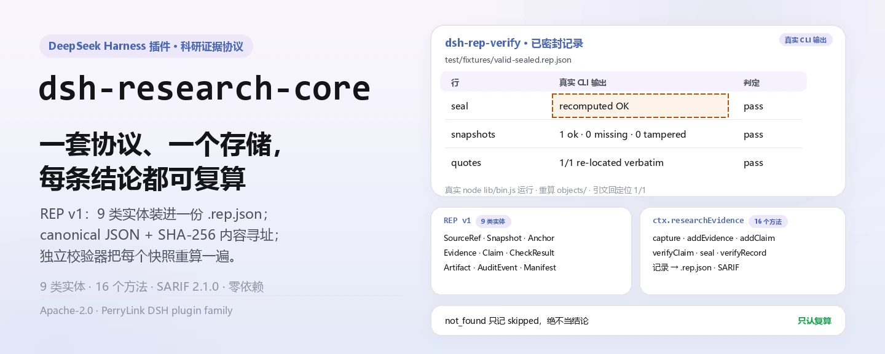
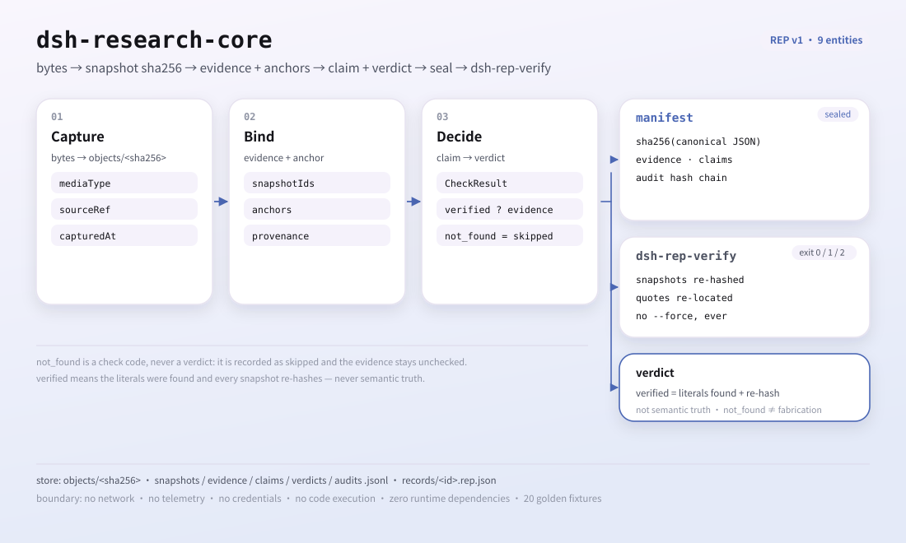
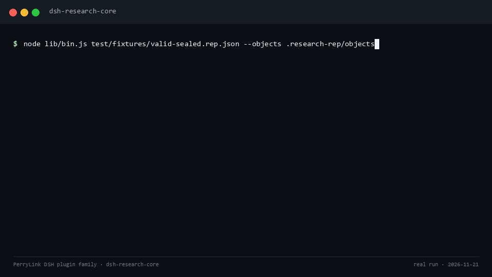

<div align="center">

<picture>
  <source media="(prefers-color-scheme: dark)" srcset="docs/assets/dsh-research-core-hero-zh-dark.webp">
  
</picture>

# @perrylink/dsh-research-core

**REP v1 —— DSH 科研插件家族的共享证据协议。**

*一套协议、一个存储、一个校验器。每个科研插件说同一种证据语言，任何人 30 秒内可复算它声称的结论。*

[English](README.md) · [Español](README-es.md) · [Português](README-pt.md) · [हिन्दी](README-hi.md)

[](LICENSE)
[]()
[](https://github.com/topics/dsh-plugin)

</div>

---

## 它是什么

`dsh-research-core` 是 18 个可独立安装的科研小插件之下的**共享层**。它只做三件事：

1. **定义 REP v1** —— `SourceRef` / `Snapshot` / `Anchor` / `Evidence` / `Claim` / `CheckResult` / `Artifact` / `AuditEvent` / `ReportManifest` 的 JSON Schema 与 TypeScript 类型，统一装进一个交换文件 `ResearchRecord`（`.rep.json`）。
2. **提供确定性原语** —— SHA-256 内容寻址、规范化 JSON、稳定 ID、不变量校验、逐字节记录校验、manifest 密封、哈希链审计事件、SARIF 2.1.0 导出。
3. **挂载可选本地服务** `ctx.researchEvidence`（内容寻址存储），并提供到既有 `dsh-research-report` 账本（`ctx.researchReport`）的**结构化桥**。

```
插件输出 ──► REP 记录 (.rep.json) ──► dsh-rep-verify ──► verified / failed
                     │
                     ├── schema/rep-v1.schema.json   契约
                     ├── objects/<sha256>            不可变字节
                     └── manifest 密封               canonical JSON 的 sha256
```


<picture>
  <source media="(prefers-color-scheme: dark)" srcset="docs/assets/dsh-research-core-flow-v5-dark.svg">
  
</picture>

*结构：捕获 → 绑定 → 判定；密封 manifest 与独立的 `dsh-rep-verify` 报告是两条输出，两份产物里的每个哈希都能从字节重算出来。图内只有实体名、方法名与 CLI 名，五语共用同一张结构图。*

## 它不做什么

- **不做检索**：Crossref / PubMed / PDF 解析都不在这里，属于各插件。
- **不做语义判断**：它不判断 claim 是否被“语义支持”，只保证字节、定位与 verdict 账本可复算。
- **不是工作台**：没有 UI、阅读器、编辑器。
- **不改造 `dsh-research-report`**：那个插件保留 `ctx.researchReport` 与其冻结的 `assemble` 契约；core 只做适配。

## 兼容性

| 项 | 值 |
|---|---|
| DeepSeek Harness | **`dsh-v0.2.2-rc.4`**（本机实测，2026-11-18）；npm peer 区间 `>=0.2.1-0 <0.3.0 \|\| >=0.2.2-0 <0.3.0` |
| Node | `^22.19.0 \|\| >=24.9.0`（实测 `24.22.1`），仅 ESM |
| Peer | `@deepseek-ai/cordis ^4.0.5-alpha.1`、`@deepseek-ai/schemastery ^3.18.5-alpha.1` |
| 运行时依赖 | **零** |

## 安装

```sh
dsh plugin --profile <name> add @perrylink/dsh-research-core          # npm
dsh plugin --profile <name> add github:PerryLink/dsh-research-core#<sha>  # git
dsh plugin --profile <name> add file:/绝对路径/dsh-research-core      # 本地
dsh --profile <name> --dump-config | grep dsh-research-core           # 确认挂载
dsh plugin --profile <name> remove @perrylink/dsh-research-core       # 卸载
```

作为库直接用也可以：`import { validateRep } from '@perrylink/dsh-research-core'` —— 服务没挂载时插件仍可用 REP 协议。

## 协议要点（REP v1）

| 实体 | 用途 | 硬不变量 |
|---|---|---|
| `SourceRef` | 来源（doi/pmid/pmcid/arxiv/isbn/url/file/dataset/other） | 按 kind 校验 id 形式 |
| `Snapshot` | 不可变、内容寻址的字节 | `snapshotId = "sha256:<hex>"`；`path` 必须等于 `objects/<hex>` |
| `Anchor` | 指向某个 snapshot 的定位（page/section/paragraph/char/table/figure/record） | 按 kind 必填字段与规范 value（`p.3`、`c.10-40`、`t.2`、`field:title`…） |
| `Evidence` | 来源 + snapshot + anchor + provenance（+ 检查） | **至少 1 个 snapshot、1 个 anchor；没有 Snapshot 的 Evidence 不合法** |
| `CheckResult` | 一次确定性检查（pass/fail/warn/skipped）+ 稳定 code | `code:"not_found"` 必须 `skipped` |
| `Claim` | 断言 + 证据绑定 + 检查 + verdict | **有 verdict 必须有 ≥1 检查；verified 必须有证据、≥1 通过的核验类检查、且无 fail** |
| `Artifact` | 代码/环境/数据/seed/命令/图/表 | `sha256:<hex>` 内容哈希 |
| `AuditEvent` | 只追加、哈希链 | `hash = sha256(canonicalJson(除 hash 外))`，`prevHash` 串联 |
| `ReportManifest` | 密封报告摘要 | `integrity.manifestHash = sha256(canonicalJson(manifest 去掉 integrity))` |

### verdict 语义（关键）

| verdict | 含义 | **不**代表 |
|---|---|---|
| `verified` | 可核验的字面量（引文/数字/元数据）都找到，且所有 snapshot 重算哈希一致 | 断言在语义上为真 |
| `unverified` | 什么都没检查（通常是没有绑定证据） | 假 |
| `insufficient` | 现有证据无法判定（例如数字可能是计算值） | 假，也**不是“干净”** |
| `contradicted` | 绑定快照完整性失败，或数值桥不一致 | — |
| `disproven` | 来源原文中明确不存在所引用的原文 span | — |

`not_found` 是**检查 code，不是 verdict**：它的意思是“没找到来源”。它**不等于造假**，也**不等于干净**；只能记为 `skipped`，且只有 `not_found` 结果的证据状态保持 `unchecked`，**永远不会变成 `ok`**。

### 规范化哈希

所有 REP 哈希都基于 canonical JSON：键按 UTF-16 code unit 排序、数字用 ECMAScript 序列化、无多余空白、`undefined` 属性省略；拒绝非有限数、bigint、循环引用、孤立代理项。对合法 JSON 值，行为与 RFC 8785（JCS）一致。

## 快速上手（作为库）

```ts
import {
  buildManifest, sealManifest, validateRep, verifyManifestSeal,
  snapshotIdOf, canonicalJson, toSarif, renderRecordMarkdown,
} from '@perrylink/dsh-research-core'

const snapshot = {
  snapshotId: snapshotIdOf(bytes),
  mediaType: 'text/plain' as const,
  bytes: bytes.byteLength,
  path: `objects/${snapshotIdOf(bytes).slice('sha256:'.length)}`,
  capturedAt: '2026-01-15T10:00:00.000Z',
  sourceRef: { kind: 'file' as const, id: 'paper.txt', retrievedAt: '2026-01-15T10:00:00.000Z' },
}
// …build evidence/claims, then:
const result = validateRep(record)            // invariants, cross-refs, audit chain, seal
const sarif = toSarif(record, { version: '1.0.0' })
const markdown = renderRecordMarkdown(record)
```

## 快速上手（作为服务）

```ts
// inside a research plugin that optionally injects researchEvidence
const service = ctx.get('researchEvidence') as ResearchEvidenceService | undefined
if (service !== undefined) {
  const { snapshot } = await service.capture({
    bytes: pdfBytes, mediaType: 'application/pdf',
    sourceRef: { kind: 'file', id: 'paper.pdf', retrievedAt: new Date().toISOString() },
  })
  await service.addEvidence({ sourceRef, snapshotIds: [snapshot.snapshotId], anchors, provenance })
  await service.addClaim({ text, type: 'result', evidenceRefs: [evidenceId], locator })
  const claim = await service.verifyClaim(claimId)       // records the verdict
  const sealed = await service.seal({ title, topic, generator })
  await service.verifyRecord(sealed.record)              // independent re-check
}
```

## CLI —— 独立校验

```sh
dsh-rep-verify <record.rep.json> [--objects <dir>] [--json] [--sarif]
```

```text
record     rec-fixture-sealed
manifest   9425dcf5… (sha256)
seal       recomputed OK
snapshots  1 ok · 0 missing · 0 tampered
quotes     1/1 re-located verbatim
issues     0 error(s) · 0 warning(s)
RESULT     verified
```

退出码：`0` 通过 · `1` 校验失败 · `2` 用法/IO 错误。不带 `--objects` 时仍校验不变量与密封，但 snapshot 哈希标为 `not_checked` —— **绝不假装校验过没读的字节**。

## 对外表面

本包**故意不注册任何模型可见工具**（工具属于 18 个插件）。对外表面为：

| 表面 | 名称 | 说明 |
|---|---|---|
| 服务 | `ctx.researchEvidence` | 16 个方法：`capture`、`addEvidence`、`setEvidenceChecks`、`addClaim`、`setVerdict`、`verifyClaim`、`get*`/`list*`、`summarize`、`buildRecord`、`seal`、`verifyRecord`，外加 `attachReport` / `importReportEvidence` / `mirrorToReport` 桥 |
| CLI | `dsh-rep-verify` | 退出码驱动，`--json` / `--sarif` |
| Schema | `./schema/rep-v1.schema.json` | JSON Schema 2020-12 |
| 事件 | `RESEARCH_EVENTS` | `research/evidence.captured`、`research/claim.verified`、`research/audit.finding`、`research/report.sealed`（只冻结名称与 payload；发送由产出插件负责） |

## 配置

| 键 | 默认 | 含义 |
|---|---|---|
| `enabled` | `true` | `false` 时什么都不挂载 |
| `root` | `.research-rep` | 存储根，相对路径按 harness 工作目录解析 |
| `maxSnapshotBytes` | `20971520`（20 MiB） | 单快照字节上限 |
| `maxEvidence` / `maxClaims` | `10000` | 注册上限，超过需先密封/清理 |

非法值在挂载期**响亮失败**。

## 存储布局

```
.research-rep/
├── objects/<sha256>          immutable snapshot bytes (atomic write, never overwritten)
├── snapshots.jsonl           snapshot registrations (first registration wins per address)
├── evidence.jsonl            evidence registrations
├── evidence-checks.jsonl     evidence checks (latest line wins)
├── claims.jsonl              claim registrations (immutable)
├── verdicts.jsonl            verdicts + their checks (latest line wins)
├── audits.jsonl              append-only hash-chained audit events
└── records/<id>.rep.json     sealed REP records
```

每个日志都是只追加的。损坏的日志行会带文件名和行号直接报错，而不是被跳过。读取时会重算 snapshot 对象的哈希，因此篡改会被发现，而不是被信任。

## 权限与数据

- **本地优先**：本包不发起任何网络请求，不上传任何内容。
- **无遥测**：没有隐藏上报、没有统计。
- **不碰凭据**：不读取、不存储令牌；审计 payload 明文规定不得含密钥。
- **不执行代码**：不执行 PDF/HTML/脚本；CLI 只读 JSON。

## 安全边界

- `snapshot.path` 必须是 `objects/<hex>` —— 合法记录**无法表达**路径穿越。
- 记录 ID 先过严格 id 正则才用于拼文件名。
- 对象写入用临时文件 + rename，且**永不覆盖**：存储字节与地址不符时直接 `SNAPSHOT_TAMPERED`，不做“修复后通过”。
- 已密封记录不覆盖（`RECORD_EXISTS`）。
- 哈希不一致是硬失败，没有 `--force`。

## 已知限制

- **记录级引文校验需要文本快照**：PDF 会被存下并重算哈希，但本包不抽文本；PDF 的引文回定位需要 `dsh-doc-anchor` 同时把抽取文本作为 `text/plain` 快照存下。
- **记录级引文检查覆盖 Evidence 的 anchor。** `verifyRecord`/`dsh-rep-verify` 回定位 `Evidence.anchors` 上的引文；claim 的 `locator.quote` 由 `evaluateClaim`/`verifyClaim` 判断——`disproven` claim 本来就应携带一个“不存在于原文”的引文。
- **`verifyClaim` 是保守的**：数字缺失 → `insufficient`（可能是计算值），只有“引文原文不存在”才 `disproven`。语义支持判断属于 `dsh-claim-check`（W2）。
- **暂不写会话事件**：事件名与 payload 已导出，写会话需要 session seam，留给产出插件。
- **单写者假设**：存储用进程内写锁；两个进程同时写同一 root 未协调。
- **Schema 与不变量分层**：`validateRep` 校验交叉引用与不变量（外加防御性结构预检），JSON Schema 是形状权威。零依赖存储只强制交叉引用与不变量，不覆盖每一条 JSON Schema 约束（例如长度上限）；不可信的生产方应在边界用 `schema/rep-v1.schema.json` 做校验。CI 用 20 个 golden fixture 双向对齐。

## 评测



*动图是 2026-11-21 真实运行的 `dsh-rep-verify` 输出 —— 先用由该记录自身快照生成的 `objects/` 目录校验 `test/fixtures/valid-sealed.rep.json`（重算密封、重算字节哈希、回定位被引用锚点）；再校验 `test/fixtures/invalid-manifest-seal.rep.json`，也就是同一份记录在密封后被改了标题，校验器直接拒绝。退出码：0 通过、1 失败、2 用法/IO 错误。*


本包**没有也不声称** precision/recall —— 它是协议基础设施，不是检测器。已量测的是：

- **115 个单元/集成测试**（11 个文件，`pnpm test`）：canonical JSON 确定性、SHA-256 向量、claim 五条 verdict 路径、不变量校验、审计链篡改、manifest 密封、存储持久化与篡改检测、Cordis 挂载/卸载、research-report 桥、CLI 退出码。
- **20 个 golden fixture**（3 个合法 + 17 个单因失效），由真实函数确定性生成，并做漂移门禁（`UPDATE_FIXTURES=1 pnpm test`）。
- **JSON Schema 对齐**：发布的 schema 接受全部合法 fixture、拒绝结构性失效 fixture；语义类 fixture 标 `either`，由 `validateRep` 覆盖。

真正的检测器（`dsh-cite-verify` / `dsh-claim-check` / `dsh-statcheck`）各自在 `dsh-research-bench` 上报告 precision/recall。

## 开发

```sh
pnpm install
pnpm run typecheck     # 源码 + 测试（strict + exactOptionalPropertyTypes）
pnpm test              # vitest
pnpm run build         # tsc → lib/
pnpm run verify:package
```

## 许可

Apache-2.0。运行时零第三方代码；开发依赖均为 MIT/Apache-2.0 工具。
